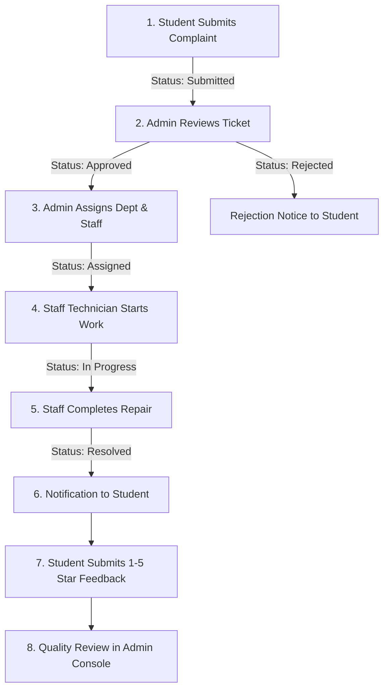

# Campus Complaint Management and Tracking System

A full-stack, responsive, and secure web application designed for college campuses. Students can submit complaints about campus facilities and services, upload issue photos, track resolution workflows in real-time, and provide feedback upon completion. Campus administrators can inspect tickets, assign specialized departments and staff technicians, manage user accounts, and generate reports. Maintenance staff can manage their assigned tasks, update work progress, and record resolution summaries.

---

## 1. Technology Stack

- **Frontend**:
  - HTML5 & Semantic Elements
  - Vanilla CSS3 (Custom design system with CSS custom properties, micro-animations, glassmorphism, responsive breakpoints, print styles)
  - Bootstrap 5.3 (via CDN)
  - Bootstrap Icons (v1.11.3 via CDN)
  - Chart.js (v4.4.1 for interactive executive analytics and reports)
  - Vanilla JavaScript (ES6+ for interactive client previews, DOM modals, and AJAX notification actions)
- **Backend**:
  - PHP 8+
  - PHP Sessions with session fixation protection (`session_regenerate_id`)
  - Role-Based Access Control (RBAC) guards
  - CSRF Token generation and verification
- **Database**:
  - MySQL 5.7+ / 8.0+ / MariaDB 10.4+
  - PDO with 100% prepared statements (parameterized queries)
  - Foreign key constraints, cascading deletions, and indexes
- **Development & Runtime Environment**:
  - XAMPP (Apache + MySQL)
  - phpMyAdmin
  - VS Code

---

## 2. Default Demonstration Login Credentials

The system includes pre-configured demo accounts for all three roles:

| Role | Full Name | Email Address | Password |
| :--- | :--- | :--- | :--- |
| **Administrator** | Demo Admin | `admin@demo.com` | `admin123` |
| **Staff Technician** | Demo Staff | `staff@demo.com` | `staff123` |
| **Staff Technician** | Sarah Jenkins (IT) | `sarah.it@demo.com` | `staff123` |
| **Staff Technician** | Michael Chang (Electrical) | `michael.elec@demo.com` | `staff123` |
| **Student** | Demo Student | `student@demo.com` | `student123` |
| **Student** | Alex Rivera | `alex.student@demo.com` | `student123` |

> [!TIP]
> On the **Login Page** (`login.php`), quick-fill buttons are provided to instantly populate student, staff, or admin credentials with a single click during testing or viva presentations!

---

## 3. Step-by-Step Installation & Setup (XAMPP)

### Step 1: Copy Project into XAMPP `htdocs`
1. Ensure your XAMPP installation directory is located at `C:\xampp` (or your custom XAMPP drive).
2. Copy or clone this project folder into `htdocs`:
   ```text
   C:\xampp\htdocs\sibi WAD project\
   ```
   *(or rename it to `C:\xampp\htdocs\campus-complaint-system\`)*

### Step 2: Start Apache and MySQL
1. Open the **XAMPP Control Panel**.
2. Click **Start** next to **Apache**.
3. Click **Start** next to **MySQL**.

### Step 3: Initialize Database (Two Easy Methods)

#### Option A: One-Click Web Installer (Recommended)
1. Open your web browser and navigate to:
   ```text
   http://localhost/sibi%20WAD%20project/setup.php
   ```
2. Click **"Initialize Database Now"**.
3. The script will automatically:
   - Connect to your MySQL server
   - Create the `campus_complaint_system` database
   - Execute `database.sql`
   - Re-hash passwords natively with PHP `password_hash()`
   - Ensure the `uploads/complaints/` directory exists
   - Provide a direct link to sign in!

#### Option B: phpMyAdmin Import
1. Open `http://localhost/phpmyadmin/`.
2. Click on the **Import** tab at the top.
3. Click **Choose File** and select `database.sql` from this project folder.
4. Click **Import** at the bottom of the page.

### Step 4: Launch the Application
Navigate to the root URL in your browser:
```text
http://localhost/sibi%20WAD%20project/index.php
```

---

## 4. Application Roles & Permissions

### 1. Student Role
- **Self-Registration**: Register account with Full Name, Email, Phone, and Password.
- **Student Dashboard**: Live KPI metrics (Total, Pending, In Progress, Resolved), recent tickets, and recent notifications.
- **Report Complaint**: Submit new complaints with Category, Campus Location, Priority, Description, and photo attachment. Automatically assigned code `CMP-YYYY-XXXXX`.
- **My Complaints**: Real server-side multi-parameter search, status filter, category filter, priority filter, and sorting.
- **Live Visual Timeline**: Track ticket progression stages dynamically.
- **Resolution Feedback**: Once resolved, rate the resolution (1 to 5 stars) and write comments.
- **Profile & Security**: Update contact info and change password.

### 2. Staff Technician Role
- **Staff Dashboard**: View assigned tasks, work in progress, and completed tasks.
- **Task Management**: Filter workload by Assigned, In Progress, and Resolved history.
- **Start Work**: Update status from `Assigned` to `In Progress` with automated timeline and student notification.
- **Resolve Complaint**: Record technical resolution notes, attach completion proof photo, and mark status as `Resolved`.

### 3. Administrator Role
- **Executive Console**: High-level KPI metrics and four dynamic Chart.js visualizations (Monthly trends, Categories doughnut, Status breakdown, Priority distribution).
- **Complaint Management**: View all complaints, search, multi-criteria filtering, approve, reject with justification, priority override, and safe deletion.
- **Task Assignment**: Delegate tickets to specialized departments (Electrical, IT, Plumbing, etc.) and assign technicians.
- **User Management**: Create staff/admin accounts, update credentials, toggle active/inactive status, and safe delete checks.
- **Staff Directory**: Inspect staff technician workloads and active assignments.
- **Department & Category CRUD**: Add, edit, and delete departments and categories with foreign-key dependency protection.
- **Quality Feedback**: Monitor student 5-star ratings, read satisfaction reviews, and track average campus ratings.
- **Reports & Analytics**: Filter analytics by date ranges and export or print official reports using dedicated print CSS (`@media print`).

---

## 5. Main Complaint Lifecycle Workflow



---

## 6. Directory and File Structure

```text
sibi WAD project/
│
├── index.php                 (Landing page with live dynamic campus statistics and workflow)
├── login.php                 (Unified authentication with role redirection and demo quick-fill)
├── register.php              (Student registration with validation and password hashing)
├── logout.php                (Session termination and cookie destruction)
├── setup.php                 (Browser-based one-click database installer)
├── database.sql              (Complete MySQL schema with 8 tables and seed data)
├── README.md                 (Project documentation and guide)
│
├── config/
│   └── database.php          (PDO connection, error handling, dynamic BASE_URL auto-detection)
│
├── includes/
│   ├── auth.php              (Session auth, role verification RBAC, CSRF helpers)
│   ├── functions.php         (Notifications, timeline logging, status badges, sanitization, image uploads)
│   ├── header.php            (HTML5 doctype, Google Fonts, Bootstrap 5.3, Bootstrap Icons)
│   ├── navbar.php            (Top navigation, notification bell dropdown, user menu)
│   ├── sidebar.php           (Modern responsive sidebar customized for student, staff, and admin)
│   └── footer.php            (Footer layout, Bootstrap JS, Chart.js, custom scripts)
│
├── student/
│   ├── dashboard.php         (Student portal overview, KPI cards, recent complaints)
│   ├── new-complaint.php     (Incident report form with image upload & MIME verification)
│   ├── my-complaints.php     (Complaints list with server-side multi-parameter filtering)
│   ├── complaint-details.php (Deep-dive ticket view with dynamic visual timeline)
│   ├── feedback.php          (1-5 star rating and comment submission handler)
│   ├── profile.php           (Student profile details and password change)
│   └── notifications.php     (Notifications center with mark-as-read functionality)
│
├── staff/
│   ├── dashboard.php         (Technician portal, KPI metrics, active workload)
│   ├── complaints.php        (Assigned task list with status filters)
│   └── complaint-details.php (Task details, Start Work action, Resolve Complaint modal)
│
├── admin/
│   ├── dashboard.php         (Executive console with 4 Chart.js charts and metrics)
│   ├── complaints.php        (Full complaint grid, search, approve, reject, delete)
│   ├── complaint-details.php (Assignment interface, department & staff selection, priority override)
│   ├── users.php             (User account CRUD, activation toggle, safe deletion)
│   ├── staff.php             (Staff directory with workload and completed task counters)
│   ├── departments.php       (Department CRUD with assignment counts)
│   ├── categories.php        (Category CRUD with complaint counts and foreign key safety)
│   ├── feedback.php          (Student feedback reviews and rating analytics)
│   └── reports.php           (Official reporting module with date filters and print stylesheet)
│
├── api/
│   └── notifications.php     (AJAX API endpoint for notifications)
│
├── uploads/
│   └── complaints/           (Directory storing uploaded issue and resolution photos)
│
└── assets/
    ├── css/
    │   └── style.css         (Custom modern design system, variables, timeline, star ratings, print styles)
    └── js/
        └── script.js         (Client-side UX enhancements, image previews, alert dismissals, sidebar toggle)
```

---

## 7. Database Tables and Relationships

The database `campus_complaint_system` contains 8 relational tables:

1. **`users`**:
   - Stores user credentials, contact details, role (`student`, `staff`, `admin`), and status (`active`, `inactive`).
   - Passwords stored as one-way Bcrypt hashes (`password_hash`).
2. **`categories`**:
   - Master list of complaint categories (Electrical, Plumbing, Wi-Fi, Classroom, Lab, Furniture, Cleaning, etc.).
3. **`departments`**:
   - Campus service departments (Electrical Department, IT Services, Maintenance & Repair, Plumbing, etc.).
4. **`complaints`**:
   - Primary complaint records with unique `complaint_code` (`CMP-2026-XXXXX`), student `user_id`, `category_id`, title, location, priority (`Low`, `Medium`, `High`), issue photo, status, resolution notes, and resolution proof photo.
5. **`assignments`**:
   - Relates a `complaint_id` to a `department_id`, assigned `staff_id`, and assigning `assigned_by` admin.
6. **`complaint_updates`**:
   - Dynamic audit log for the complaint timeline: records `complaint_id`, `user_id`, `old_status`, `new_status`, timestamp, and remarks.
7. **`feedback`**:
   - Stores student ratings (1 to 5 stars) and comments. Uses a `UNIQUE(complaint_id)` constraint to enforce single feedback per complaint.
8. **`notifications`**:
   - In-app notification messages sent to students, staff, and admins upon workflow state transitions.

---

## 8. Security Highlights

- **SQL Injection Prevention**: 100% of SQL queries use PDO prepared statements with parameter binding.
- **Cross-Site Scripting (XSS) Prevention**: All dynamic user-supplied data is sanitized through `htmlspecialchars($val, ENT_QUOTES, 'UTF-8')`.
- **Cross-Site Request Forgery (CSRF)**: Cryptographically secure CSRF tokens (`bin2hex(random_bytes(32))`) embedded and verified on all state-altering POST forms.
- **Password Security**: Native PHP `password_hash()` and `password_verify()` with Bcrypt algorithm.
- **Secure File Uploads**:
  - Whitelist of permitted extensions (`jpg`, `jpeg`, `png`, `webp`).
  - Verification of MIME type (`image/jpeg`, `image/png`, `image/webp`) using `finfo` / `mime_content_type`.
  - Generation of cryptographically random unique filenames (`bin2hex(random_bytes(6))`).
  - Hard limit of 5MB per upload.
- **Role-Based Access Control (RBAC)**: Protected views enforce `requireRole(['student'])`, `requireRole(['staff'])`, or `requireRole(['admin'])` at the top of every script to block unauthorized URL access.

---

## 9. Viva / Presentation Talking Points

1. **Architecture**: Modular MVC-inspired PHP architecture with centralized configuration, reusable presentation components (`header`, `navbar`, `sidebar`, `footer`), and separated business logic.
2. **Dynamic Workflows**: Demonstrates realistic campus operations where tickets transition across clear stages (Submitted &rarr; Approved &rarr; Assigned &rarr; In Progress &rarr; Resolved &rarr; Feedback).
3. **Audit Trail**: The `complaint_updates` table ensures every stage transition has an accountable timestamp, actor, and comment.
4. **Clean Relational Schema**: Referential integrity enforced with appropriate foreign keys (`ON DELETE RESTRICT` where records must not be orphaned, `CASCADE` where child logs depend on the complaint).
5. **Modern Aesthetics**: Built using curated design tokens (Vibrant Blue `#2563EB`, Slate Dark `#0F172A`), Google Fonts Plus Jakarta Sans, micro-animations, interactive Chart.js analytics, and mobile responsive layouts.
